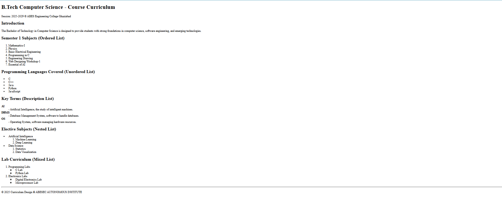

# Experiment 1 – B.Tech Computer Science Course Curriculum

A course curriculum webpage built with HTML lists.

## Objectives
- Create a webpage using basic HTML tags (headings, paragraphs, special characters)
- Use all types of HTML lists

## Features
- **Ordered list** – Semester 1 subjects
- **Unordered list** – Programming languages covered
- **Description list** – Key terms (AI, DBMS, OS)
- **Nested list** – Elective subjects (Artificial Intelligence, Data Science)
- **Mixed list** – Lab curriculum (ordered list with unordered sub-lists)

## How to Run
1. Download or clone this repository
2. Open `index.html` in any web browser (or use the Live Server extension in VS Code)

## Output

## Outcome
- Successfully created a course curriculum webpage using HTML
- Implemented ordered, unordered, description, nested and mixed lists
- Learned to organize information in a structured webpage format
